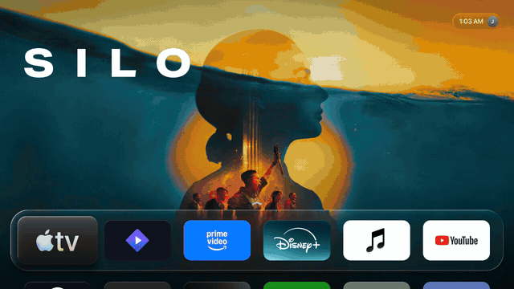
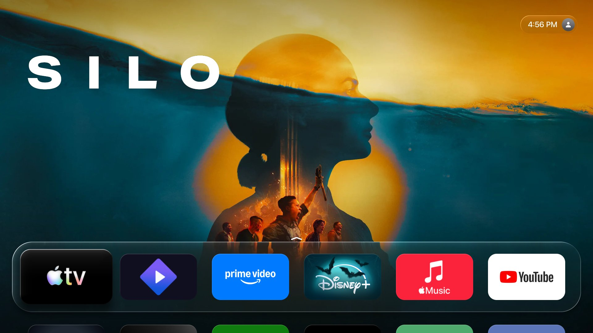
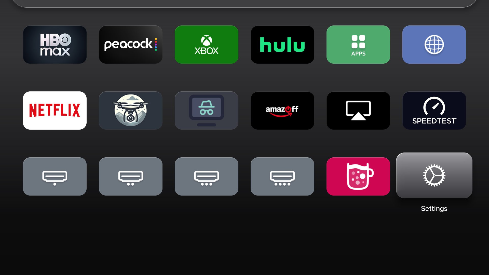
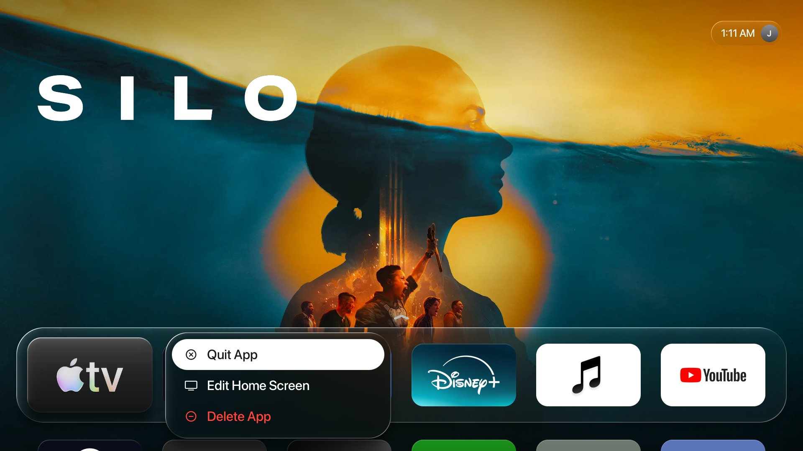
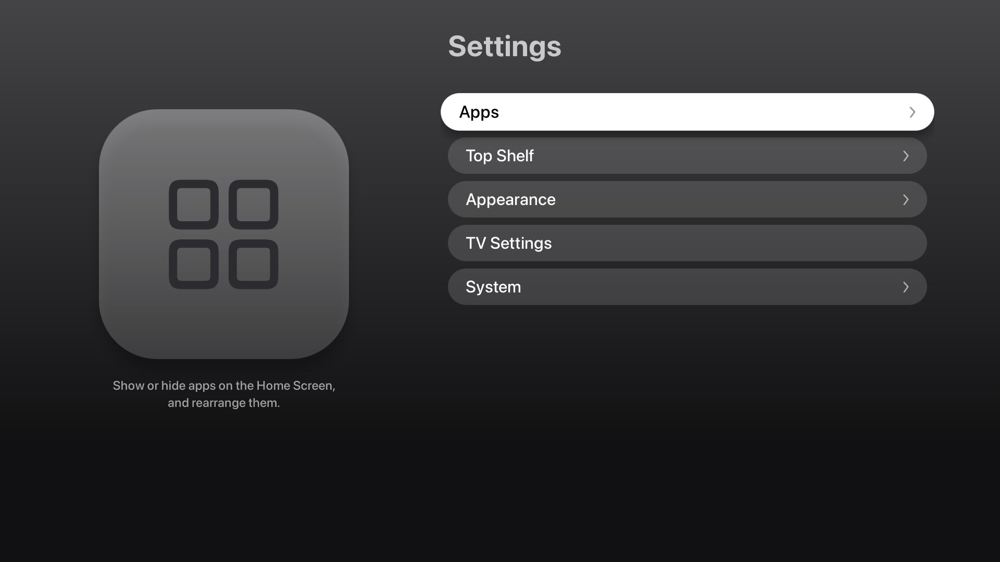

# ATLauncher

> [!NOTE]
> After installation, please create a issue with your TV model and webOS version to add to the compatibility list

A native Home Screen for rooted LG webOS TVs, inspired by Apple TV.



> [!WARNING]
> **Still in testing.** ATLauncher works day to day on the TV it was built on, but it has only been tested on that one
> model and there may be bugs. Read [Testing status](#testing-status) before replacing LG Home.

ATLauncher is a QML app run by the TV's own Qt (no runtime to install), drawn on the GPU at a steady ~58 fps on a
budget webOS 25 set. It can take over the Home button, so it *is* the TV's Home screen.

- **Dock and app grid**: a Liquid Glass Dock whose rounded edge bends the picture behind it, a 6-column grid,
  rim-lit icons, and tilt-toward-the-move focus.
- **App icons**: each app's Apple TV icon from the App Store, fetched by the TV; apps without one keep their own
  webOS icon. The TV's own icons for its HDMI inputs, Internet, App Store and AirPlay.
- **Top Shelf**: a splash for each app; rest on Netflix, Prime Video, Disney+, Hulu or Apple TV for 5 seconds and
  its popular shows appear from [TMDB](https://www.themoviedb.org) (full-screen carousel or a "Top Shows" row).
- **App menu**: hold OK on an app for Quit App (while it runs), Edit Home Screen and Delete App.
- **Settings**: per app, show or hide it, turn its App Store icon on or off, quit or delete it; rearrange apps; Top
  Shelf, Dock and icon options; LG's quick settings; and a way back to LG Home.
- **Remote**: Home returns to the app you were on (press again for the first app); the Settings and Input keys open
  ATLauncher's Settings and inputs row; Back works throughout, and the Magic Remote pointer stays hidden for these keys.

| | |
| --- | --- |
|  |  |
| Home Screen: Top Shelf above the Liquid Glass Dock | App grid: App Store tiles, the TV's own icons, SF Symbols gear |
|  |  |
| Hold OK: Quit App, Edit Home Screen, Delete App | Settings |

<sub>Screenshots from an LG UR8000 with SF Pro installed. Show art comes from TMDB at run time and is not part of
ATLauncher.</sub>

## Testing status

ATLauncher 1.0 is tested on one TV (below); other models, firmware and regions are untested. It changes how the TV
starts, so before replacing LG Home, make sure you can reach the TV's root shell over SSH: that is how you undo it.

**Getting LG Home back**

- **Settings → System → Restart into LG Home** restarts once into LG Home; the restart after that brings ATLauncher back.
- `sh /var/lib/atlauncher/atlauncher.sh disable` (SSH, as root) turns the takeover off for good, immediately.
- If the TV ever starts to a black screen, connect over SSH and run `disable`. Homebrew Channel's own failsafe
  options (in its settings) can also skip startup scripts.

**Known issues and limits**

- Enabling or disabling the takeover restarts the TV's app manager, so open apps close. Once, during development, the
  TV rebooted at that moment; it came back with ATLauncher working.
- Play and More Info open the app, not the show: TMDB data doesn't say where a show is inside each app.
- App Store icons are matched by name for apps outside the built-in list and can pick the wrong app; fix it in
  `store-ids.json` (see [App Store icons](#app-store-icons)). Seasonal App Store icons (Halloween art, etc.) appear
  as Apple ships them.
- Some LG apps ship a plain grey splash; add your own in [Custom art](#custom-art).
- The Magic Remote pointer is kept hidden only for the Home, Settings and Input keys.

**Reporting a bug**

Open an [issue](https://github.com/ratelimits/atlauncher/issues) with your TV model and webOS version, what you did,
and `/var/lib/atlauncher/boot.log`. For icon problems, include `/var/lib/atlauncher/storeicons/index.json`.

## Compatibility

| TV | Model identifier | webOS | Takeover |
| -- | ---------------- | ----- | -------- |
| LG UR8000 | `??UR8000AUA` | 25 (10.3.1) | ✅ |
| LG C5 | `OLEDC5??AUA` | 25 (10.3.1) | ✅ |

> [!NOTE]
> `??` is the screen size. The UR8000 shipped with webOS 23 and runs webOS 25 after LG's webOS Re:New update.

ATLauncher needs a **rooted** TV with [Homebrew Channel](https://github.com/webosbrew/webos-homebrew-channel) (elevated)
and LG's `qml-runner` (present on webOS 25; other versions are untested). Reports for other models are welcome.

## Installation

### Homebrew Channel

Add this repository in Homebrew Channel's settings:

```text
https://github.com/ratelimits/atlauncher/releases/latest/download/repo.json
```

### SSH

Download `com.ratelimits.atlauncher_<version>_all.ipk` from the
[latest release](https://github.com/ratelimits/atlauncher/releases/latest). On your computer, replace `TV_IP`:

```sh
scp -O com.ratelimits.atlauncher_1.0.0_all.ipk root@TV_IP:/tmp/atlauncher.ipk
ssh root@TV_IP
```

In the TV's root shell:

```sh
luna-send -i luna://com.webos.appInstallService/dev/install \
  '{"id":"com.ratelimits.atlauncher","ipkUrl":"/tmp/atlauncher.ipk","subscribe":true}'
```

The command keeps reporting progress after the install: once its output says `installed`, press Ctrl+C.
Open **ATLauncher** from the app list to try it as a normal app. To update later, install the new IPK the same way,
then run `sh /var/lib/atlauncher/atlauncher.sh relink` if ATLauncher is your Home app.

## Replacing LG Home

> [!WARNING]
> This changes how your TV starts. It writes nothing to the system partition and can be undone, but disable it
> before uninstalling ATLauncher. Use at your own risk.

In the TV's root shell:

```sh
sh /media/developer/apps/usr/palm/applications/com.ratelimits.atlauncher/tools/atlauncher.sh enable
```

This mounts ATLauncher over LG Home's folder (LG's files stay untouched underneath), maps the Home, Settings and Input
keys to ATLauncher, and installs Homebrew Channel boot hooks that re-apply it at every boot. The app manager restarts
once, so open apps close. `enable` also asks for your initial, shown in the circle next to the clock (press Enter to
skip and keep the person icon).

```sh
sh /var/lib/atlauncher/atlauncher.sh status
sh /var/lib/atlauncher/atlauncher.sh disable     # LG Home back immediately
sh /var/lib/atlauncher/atlauncher.sh relink      # after installing an update
sh /var/lib/atlauncher/atlauncher.sh initial J   # the letter next to the clock ("clear" for the person icon)
```

To use LG Home once without disabling anything: **Settings → System → Restart into LG Home**; the restart after that
brings ATLauncher back. Boot log: `/var/lib/atlauncher/boot.log`.

<details>
<summary>How it works</summary>

- `/var/lib/atlauncher/home-overlay` holds an `appinfo.json` that claims LG Home's id (`com.webos.app.home`, type `qml`)
  and symlinks to ATLauncher's files; it is bind-mounted over `/usr/palm/applications/com.webos.app.home` before the app
  manager (SAM) starts, so SAM launches ATLauncher as Home.
- The remote keys go through a surface-manager key filter (`homekey.js`) added to the runtime config
  `com.webos.surfacemanager.keyFilters`; the original list is saved and restored by `disable`.
- The window declares `_WEBOS_ACCESS_POLICY_KEYS_BACK`, so Back stays inside ATLauncher instead of offering to exit.
- If the app manager ever restarts after the media server, the media server loses track of which app is in front
  and every app's video stays black (sound plays). ATLauncher's boot step checks for this and restarts the media server.
- `apps-watch.sh` keeps the installed-app list (`/var/lib/atlauncher/apps.json`), each app's own icon and splash, and
  the App Store icons current.

</details>

## TMDB (popular shows)

Popular shows need your own free API key: create one at
[themoviedb.org/settings/api](https://www.themoviedb.org/settings/api), then:

```sh
echo YOUR_API_KEY | ssh root@TV_IP 'mkdir -p /var/lib/atlauncher && cat > /var/lib/atlauncher/tmdb.key'
```

Reopen ATLauncher. Without a key, each app's splash is shown. You can also turn it off in **Settings → Top Shelf**.
While a show is open full-screen, a small credit reads "Uses the TMDB API · not endorsed or certified by TMDB".

## App Store icons

With **Settings → Appearance → App Store Icons** on (the default), the TV looks each app up on Apple's App Store and
uses its Apple TV icon as the tile. Icons are downloaded once by the TV into `/var/lib/atlauncher/storeicons/` (none
are bundled) and refreshed monthly. Apps without an Apple TV version keep their own webOS icon, drawn at
**Settings → Appearance → Icon Size** (Medium by default). Popular apps use exact App Store ids; others are matched by
name, accepting only a close match.

In **Settings → Apps → *app***, **App Store Icon** turns it off for that app; turning it back on downloads it again.
To fix a wrong match, or never look an app up, add it to `/var/lib/atlauncher/store-ids.json` (the App Store id is the
number in its `apps.apple.com` link):

```json
{ "io.strem.tv": null, "some.app.id": 123456789 }
```

## Custom art

Your own pictures on the TV, named by app id, are used before anything else:

| Folder | Size | Used for |
| ------ | ---- | -------- |
| `/var/lib/atlauncher/custom/icons/<app id>.png` | 500×300 | the app's tile |
| `/var/lib/atlauncher/custom/art/<app id>.png` (or `.jpg`) | 1920×1080 | the app's Top Shelf splash |

App ids are listed in `/var/lib/atlauncher/apps.json`. Changes appear within about five minutes, or after a restart.

## Moving your arrangement

To bring an app order over from another launcher, put `/var/lib/atlauncher/import.json` on the TV, then reopen
ATLauncher. It is applied once per `id` (change the `id` to apply it again):

```json
{ "id": "my-layout-1", "order": ["netflix", "youtube.leanback.v4", "hulu"], "hidden": ["some.app.id"] }
```

## Recommended screensaver

ATLauncher pairs well with [Aerial Screensaver](https://repo.webosbrew.org/apps/org.aabytt.webos.custom-screensaver-aerial)
by aabytt ([source](https://github.com/aabytt/custom-screensaver-aerial)), which replaces LG's screensaver with
Apple TV-style aerial footage. Install it from Homebrew Channel, open it once and choose **Apply**.

ATLauncher's picks keep just 12 of its videos, played in 4K HEVC: San Francisco Evening; Sonoma Horizon, Evening,
Clouds and from Above; Sequoia Sunrise, Morning and Night; Tahoe Day, Morning, Evening and Night. They are in
`atlauncher-aerial-picks.tar.gz` with each release (and [extras/aerial](extras/aerial) here). On the TV:

```sh
cd /tmp && tar xzf atlauncher-aerial-picks.tar.gz && sh aerial/apply-picks.sh
sh /tmp/aerial/apply-picks.sh restore     # back to the add-on's full list
```

The add-on's own files are backed up to `/var/lib/atlauncher/aerial-backup` first. Updating the add-on resets its list;
run `apply-picks.sh` again afterwards. No video is included with ATLauncher: the add-on streams them.

## Using SF Pro (optional)

ATLauncher ships with [Inter](https://rsms.me/inter/) and [Lucide](https://lucide.dev) icons. If you'd rather use
Apple's SF Pro, download it yourself from [developer.apple.com/fonts](https://developer.apple.com/fonts/) (it is not
included: Apple's license doesn't allow redistributing it, and limits it to Apple platforms, so check it covers your
use). Copy these four files from the installer to the TV, then reopen ATLauncher:

```sh
ssh root@TV_IP mkdir -p /var/lib/atlauncher/fonts
scp -O SF-Pro-Display-Regular.otf SF-Pro-Display-Medium.otf SF-Pro-Display-Semibold.otf \
  SF-Pro-Display-Bold.otf root@TV_IP:/var/lib/atlauncher/fonts/
```

ATLauncher uses SF Pro whenever the regular weight is there (`.otf` or `.ttf`), and Inter otherwise. With SF Pro, its
icons are SF Symbols drawn from the font you installed: the Settings tile and pictures, the app menu, the chevron and
the person icon. Delete the folder to go back. For the desktop preview, put the files in `app/userfonts/` (ignored by
git and never packaged).

## Development

The desktop preview needs Qt 5 (`brew install qt@5`):

```sh
QML_XHR_ALLOW_FILE_READ=1 /opt/homebrew/opt/qt@5/bin/qmlscene app/preview.qml
```

Arrows move, Return is OK (hold for the app menu), Esc is Back. For TMDB in the preview, put your key in
`app/tmdb.key` (ignored by git). Scripted runs: `--steps="keys:Right,Up wait:800 shot:/tmp/a.png"`.

Build locally (needs Node for LG's `ares-package`, fetched with `npx`):

```sh
scripts/build.sh            # dist/: IPK, sha256sums, repo.json, description.html, app-icon-large.png, aerial picks
scripts/render-assets.py    # re-render the Lucide glyphs, Settings tile, AirPlay splash and app icon (needs Chrome)
```

ATLauncher targets the TV's Qt 5.12: no `required` properties, `?.` or `??`.

### Releases

Set the version in `app/appinfo.json`, add it to `CHANGELOG.md`, then push a matching tag:

```sh
git tag v1.0.1 && git push origin v1.0.1
```

The **Release** workflow builds the IPK and publishes a GitHub release with it, `repo.json` (for Homebrew Channel),
`sha256sums`, `description.html`, the icon and the Aerial picks.

## Privacy

ATLauncher talks to the TV's own services; with your TMDB key, to `api.themoviedb.org` and `image.tmdb.org`; and with
App Store Icons on, to `itunes.apple.com`, `apps.apple.com` and Apple's image server (`*.mzstatic.com`) to fetch app
icons. There is no telemetry. Settings, the TMDB cache and the icons stay on the TV.

## License

MIT, see [LICENSE](LICENSE). Bundled fonts, icons and artwork are covered in [NOTICE.md](NOTICE.md).

ATLauncher is not affiliated with LG, Apple, TMDB or any app or brand shown in its UI. App names, logos and splash art
belong to their owners. Apple TV is a trademark of Apple Inc.; webOS is a trademark of LG Electronics.
